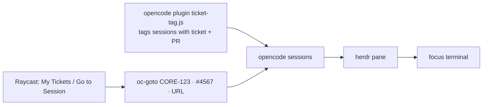

# oc-goto

Jump from a Linear ticket or GitHub PR to the [opencode](https://opencode.ai) session working on it, in its [herdr](https://herdr.dev) pane.



| Piece | What it does |
|---|---|
| `opencode/ticket-tag.js` | Tags each session with its Linear ticket and PR: `metadata.ticket/pr` plus a title prefix `CORE-123 #4567 · …` |
| `bin/oc-goto` | Ticket/PR/URL/branch (or clipboard) → focus the session's herdr pane; resume it in a new tab; or create the worktree and start a session |
| `raycast/script-commands/go-to-session.sh` | Raycast command wrapping `oc-goto` |
| `raycast/my-tickets` | Raycast extension: your Linear issues with session status badges, ↵ jumps to the session |

## How sessions are matched

| Tag source (first wins, then sticky) | ticket | PR |
|---|---|---|
| user prompt: Linear URL, `KEY-123`, PR link / `PR 4567` | ✓ (replaces a branch-inferred ticket) | ✓ |
| session worktree branch (`key-123-…`) | ✓ | via `gh pr list --head` |
| `gh pr create` output | | ✓ |
| PR head branch | ✓ | |

| `oc-goto` finds | Action |
|---|---|
| session open in a herdr pane | focus it |
| other agent pane with the ticket/PR in its title (Claude Code, Codex…) | focus it |
| session, no pane | new herdr tab: `opencode -s <id>` |
| nothing (also not via the ticket's PR) | new herdr tab: reuse or create the worktree, start opencode with a kickoff prompt |

## Install

Needs macOS, `jq`, `gh` (logged in), `git`, opencode V2, herdr, and `LINEAR_API_KEY` in `~/.zprofile`.

```sh
git clone https://github.com/culda/oc-goto ~/oc-goto
~/oc-goto/install.sh ~/my-repo
```

`install.sh` symlinks the pieces and writes `~/.config/oc-goto/config.json` (see `config.example.json`):

| Key | Meaning |
|---|---|
| `repo` | main checkout; worktrees are created from it |
| `githubRepo` | `owner/name` for PR lookups |
| `worktreePrefix` | new worktrees go to `<prefix><ticket>`, e.g. `~/my-repo-eng-123` |
| `herdrWorkspace` | herdr workspace label for new tabs (falls back to the focused one) |
| `terminalApp` | app brought to front after focusing |
| `ticketKeys` | Linear team keys, so free text like `UTF-8` is not read as a ticket |

New worktrees use `wt new <dir> <branch>` when a `wt` command is on PATH, else `git worktree add`.

Raycast: add `~/.config/raycast/script-commands` under Settings → Extensions → Script Commands, or install **My Tickets** (`cd raycast/my-tickets && npm install && npm run dev`).

## Debugging

```sh
OC_GOTO_DRY_RUN=1 oc-goto CORE-123   # print the herdr action instead of running it
oc-goto --index                      # every ticket/PR with a session, and its status
tail ~/.local/state/opencode-ticket-tag.log
```
